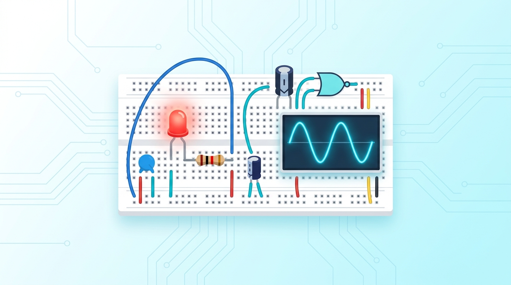
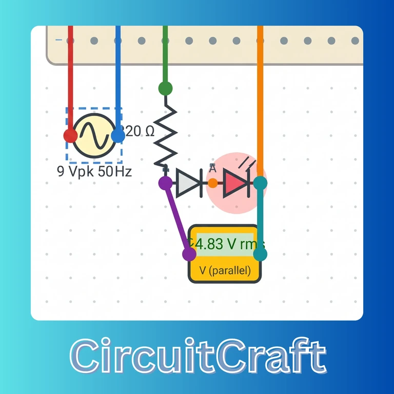
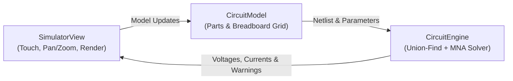

<div align="center">



<br/>



# ⚡ CircuitCraft
### *Interactive Electronics Lab Companion for Android*

[-3DDC84?style=for-the-badge&logo=android&logoColor=white)](https://developer.android.com)
[](https://www.java.com)
[](https://firebase.google.com)
[](LICENSE)

<br/>

**CircuitCraft** is an all-in-one virtual electronics lab and learning companion for Android. Build and test analog & digital circuits on an interactive solderless breadboard, calculate Ohm's Law values on the fly, explore an illustrated 23-part component guide, challenge yourself with timed electronics quizzes, and compete on a live leaderboard—all backed by a real-time **Modified Nodal Analysis (MNA)** simulation engine.

[Install APK](#-install-release-apk) • [App Features](#-app-features) • [Simulation Engine](#-how-the-simulator-works) • [Architecture](#-android-architecture) • [Project Structure](#-project-structure) • [Getting Started](#-getting-started)

</div>

---

## 📲 Install Release APK

Want to try the app right away without opening Android Studio?

- Download and install **[`app/release/app-release.apk`](app/release/app-release.apk)** on any Android 7.0+ (API 24+) phone or emulator.
- Once installed, you can also share the APK directly with friends from the in-app dashboard via **Share this app** (`AppSharer` + `FileProvider`).

---

## 🌟 App Features

### 1. 🔐 Splash & Firebase Authentication (`SplashActivity`, `LoginActivity`, `RegisterActivity`)
- **2-Second Branded Splash:** Launches into an animated logo screen and automatically skips Login if you are already signed in.
- **Account Sign-Up & Sign-In:** Email/password authentication via **Firebase Auth** with input validation (valid email format, 6+ character password, password confirmation match).
- **Cloud User Profiles:** Saves your display name and email to **Cloud Firestore** (`users/{uid}`) upon registration.

---

### 2. 🏠 Smart Dashboard & Live System Alerts (`MainActivity`)
- **Personalized Home Hub:** Greets you by name/email and provides one-tap access to all 6 core modules:
  - 🔌 **Components Library**
  - 🧮 **Ohm's Law Calculator**
  - 🔬 **Circuit Lab (Simulator)**
  - 📝 **Circuit Quiz**
  - 🏆 **Leaderboard**
  - ⭐ **Favourite Circuits**
- **Textbook Quick Link:** Opens the *All About Circuits* online textbook in your browser (`ACTION_VIEW`).
- **One-Tap App Sharing (`AppSharer`):** Copies the installed APK into app cache, exposes it safely via `FileProvider`, and launches Android's share sheet with both the `.apk` file and GitHub repository link.
- **Live Connectivity & Device Banners:**
  - Shows a red offline alert (`NetworkReceiver`) when internet is unavailable (letting you know the quiz switches to offline questions).
  - Shows amber warnings (`SystemEventReceiver`) for **low battery** (`<= 15%`, non-charging) and **airplane mode** (cloud features require internet).

---

### 3. 🔬 Interactive Circuit Lab Simulator (`LabActivity`, `SimulatorView`, `CircuitModel`)
- **Expanded `900 × 1300` Workbench:** Drag empty space to pan, pinch-to-zoom smoothly, and tap **`🔍 View`** to toggle between breadboard close-up and the full workbench overview.
- **20-Column Solderless Breadboard:** Realistic top/bottom power rails plus split `a–e` and `f–j` tie-point strips with grid snapping and non-overlapping automatic placement for newly added parts.
- **Complete 23-Item Palette (`PartType`):**
  - **Power & Timing:** DC Battery (default `9 V`), AC Source (configurable peak voltage & frequency), Square-Wave Clock (`0–5 V`, 50% duty cycle, `0.05–1000 Hz`), Breadboard, Jumper Wires
  - **Passives & Control:** Resistor, Capacitor, Switch (tap on the board or via Value to toggle `ON` / `OFF`)
  - **Semiconductors:** Diode, LED, **NPN Transistor**, **PNP Transistor**
  - **Measuring Instruments:** Voltmeter (`10 MΩ` parallel meter), Ammeter (series branch meter), **Multimeter** (switchable between Voltmeter and Ammeter modes)
  - **Digital Logic ICs:** `AND`, `OR`, `NAND`, `NOR`, `XOR`, `XNOR`, `NOT` gates, plus rising-edge **D Flip-Flop IC** (`D`, `CK`, `Q`, `Q̅`)
- **Full Workbench Toolbar:**
  - **`▶ Run / ■ Stop`:** Starts or stops the real-time MNA simulation loop (`30 ms` UI ticks), updating live meter values (`DC` mean or `~AC rms`) and proportional LED brightness.
  - **`🔍 View`:** Toggles between breadboard focus and full-workbench overview.
  - **`⟳ Rotate`:** Rotates selected parts in 90° steps.
  - **`✎ Value`:** Edits resistance (`220`, `4.7k`, `1M`), capacitance (`µF`), battery voltage, AC peak & frequency, Clock frequency (`0.05–1000 Hz`), or toggles Switch / Multimeter mode using SI prefixes (`Units`).
  - **`🗑 Delete`:** Removes the selected component or jumper wire.
  - **`⚠ Check`:** Inspects static wiring and live simulation diagnostics.
  - **`⭐ Save`:** Names and saves the entire circuit (`CircuitIO` JSON + parts summary) to Favourite Circuits.
- **Rotation & Low-Battery Safeguards:** `LabViewModel` keeps your circuit and running state alive across orientation changes (with a dedicated landscape layout), and `SystemEventReceiver` automatically pauses simulation on low battery to save power.

---

### 4. ⚠️ Real-Time Safety & Circuit Diagnostics (`CircuitEngine`)
- **LED Burnout Protection:** Triggers a visual burnout state and warning if forward LED current exceeds **`40 mA`**.
- **Short-Circuit Detection:** Alerts immediately when source current exceeds **`2.0 A`**.
- **Reverse-Bias Warning:** Flags LEDs wired backward (`Vd < -1.0 V`).
- **Ammeter Placement Guard:** Warns if an ammeter (or Multimeter in Ammeter mode) carries over **`1.0 A`** across a source instead of being wired in series.
- **Wiring & Power Checks:** Detects missing power sources (requires DC Battery, AC Source, or Clock) and unconnected required component pins.

---

### 5. 📚 Components Reference Library (`ComponentsActivity`, `ComponentRepository`)
- Scrollable encyclopedia covering all **23** parts, sources, instruments, logic gates, and prototyping elements.
- Tap any component card to view its explanation, pinout notes, and a **`⚠ Common mistake`** tip to avoid real-world wiring errors.

---

### 6. 🧮 Ohm's Law & Power Calculator (`CalculatorActivity`, `CircuitCalculator`)
- Enter any **two** values among Voltage ($V$), Current ($I$), and Resistance ($R$) and leave the third blank to solve immediately:
  - $V = I \times R$
  - $I = V \div R$
  - $R = V \div I$
- Displays the step-by-step formula alongside calculated Power ($P = V \times I$), with validation against empty/invalid inputs and zero-resistance short circuits.

---

### 7. 🧠 Timed Electronics Quiz (`QuizActivity`, `QuizRepository`, `QuizTimerService`)
- **30-Question Bank:** Downloads live questions from GitHub JSON over `HttpURLConnection` and automatically falls back to the offline asset [`assets/questions.json`](app/src/main/assets/questions.json) if you are offline.
- **Instant Explanations:** Every answer check shows color-coded feedback and a clear explanation before advancing.
- **Foreground Stopwatch Notification (`QuizTimerService`):** Runs an active Android foreground service that updates a persistent notification every second (`Elapsed time MM:SS`) and broadcasts `ACTION_TICK` to the UI (`POST_NOTIFICATIONS` runtime permission supported on Android 13+).
- **Rotation-Proof State:** `QuizViewModel` preserves questions, selected answers, score, and elapsed timer across screen rotation.

---

### 8. 🏆 Live Top-20 Leaderboard (`LeaderboardActivity`, `ScoreRepository`, `RealtimeDb`)
- **Real-Time Updates:** Powered by **Firebase Realtime Database** (`ValueEventListener`), updating automatically the moment anyone completes a quiz—no manual refresh needed.
- **Personal Best & Tie-Breaking:** Stores every attempt in Cloud Firestore (`scores`) and saves each user's best score to `leaderboard/{uid}` in Realtime Database, ranking the Top 20 by highest score and fastest completion time while highlighting your own row.

---

### 9. ⭐ Favourite Circuits & Contact Sharing (`FavouritesActivity`, `FavouriteProvider`, `FavouriteRepository`)
- **Local SQLite + Cloud Sync:** Saves circuits locally in SQLite via a custom `ContentProvider` (`FavouriteProvider`) and mirrors them to Cloud Firestore (`users/{uid}/favourites`).
- **One-Tap Reopen:** Tap any saved circuit to load its full JSON build back into the **Circuit Lab** for editing and simulation.
- **Share with Contacts:** Queries device contacts with email addresses via Android's `ContactsContract` (`READ_CONTACTS` runtime permission) to compose a prefilled email (`ACTION_SENDTO`), or falls back to the system share sheet (`ACTION_SEND`).

---

### 10. 🌙 Adaptive Dark Mode & Responsive UI (`BaseActivity`, `ThemeHelper`, `CircuitCraftApp`)
- **Sun / Moon Top-Bar Toggle:** Every screen inheriting `BaseActivity` includes a persistent theme toggle saved in `SharedPreferences` (follows system theme until toggled).
- **Custom Night Palette:** Uses `values-night/colors.xml` for crisp dark-mode readability while intentionally keeping the circuit workbench paper light so components and colored jumper wires stay clear.
- **Landscape Support:** Every screen supports rotation, with dedicated `layout-land/` layouts for Login and Circuit Lab.

---

## ⚙️ How the Simulator Works

`CircuitEngine` runs independently of Android UI code and solves the active circuit using **Modified Nodal Analysis (MNA)**:



1. **Topology Discovery (Union-Find):**
   Breadboard power rails, 5-hole columns (`a–e` and `f–j`), and jumper wires are grouped into electrical nets using a disjoint-set union-find structure. Ground (`node 0`) is referenced to the negative pin of the first DC Battery, AC Source, or standalone Clock.
2. **Matrix Formulation ($A \cdot x = b$):**
   - **Linear Devices:** Resistors, sources (`0.1 Ω` internal resistance), switches, and voltmeters (`10 MΩ`) are stamped directly into the conductance matrix; ammeters introduce extra branch-current unknowns.
   - **Capacitors:** Modeled per step ($\Delta t = 10^{-4}\text{ s}$) with a Backward-Euler companion conductance ($G_{eq} = C / \Delta t$).
   - **Nonlinear Semiconductors (Diodes, LEDs, NPN & PNP BJTs):** Solved iteratively using **Newton-Raphson** (up to 80 iterations) with Ebers-Moll equations and SPICE-style P-N junction limiting (`pnjlim`) for convergence.
   - **Digital Logic & Clock:** Logic gates, square-wave Clock, and rising-edge D Flip-Flops sample prior node voltages against a `2.5 V` threshold and drive `5 V` / `0 V` outputs.
3. **Linear Solve & Averaging Window:**
   Each timestep is solved via Gaussian elimination with partial pivoting (`300` steps per `30 ms` tick). Meters average samples over `1000`-step windows (skipping the initial startup transient) and automatically distinguish DC mean readings from AC RMS readings.

---

## 🏛️ Android Architecture

```text
com.circuitcraft.app
├── CircuitCraftApp.java       # Application startup & saved night-mode initialization
├── MainActivity.java          # Dashboard, explicit/implicit intents, network & system alerts
├── data/                      # DbHelper (SQLite), FavouriteProvider (ContentProvider), Repositories & RealtimeDb
├── logic/                     # CircuitCalculator (Ohm's Law & Power) and Units (SI formatting/parsing)
├── model/                     # ComponentItem, Favourite, QuizQuestion, LeaderboardEntry
├── receiver/                  # NetworkReceiver & SystemEventReceiver (low battery, airplane mode)
├── service/                   # QuizTimerService (foreground stopwatch + notification broadcasts)
├── sim/                       # PartType, Part, CircuitModel, CircuitEngine, CircuitIO, SimulatorView
└── ui/                        # BaseActivity, ThemeHelper, AppSharer, ViewModels, Adapters & 9 Feature Activities
```

---

## 📂 Project Structure

```text
CircuitCraft/
├── app/
│   ├── release/
│   │   ├── app-release.apk                # Ready-to-install release APK
│   │   └── output-metadata.json
│   ├── src/main/
│   │   ├── AndroidManifest.xml            # 10 activities, QuizTimerService, FavouriteProvider & FileProvider
│   │   ├── assets/questions.json          # Offline fallback bank (30 quiz questions)
│   │   ├── java/com/circuitcraft/app/     # Core app, data, logic, model, receiver, service, sim, ui
│   │   └── res/                           # drawables, drawable-nodpi, layout, layout-land, menu, mipmap, values, values-night, xml
│   └── build.gradle                       # App module build config (compileSdk 33, minSdk 24)
├── docs/
│   └── circuitcraft-banner.jpg            # README hero illustration
├── gradle/
│   ├── libs.versions.toml                 # Gradle version catalog (AGP, Material, Firebase BOM 32.0.0)
│   └── wrapper/gradle-wrapper.properties  # Gradle 8.0 wrapper settings
├── build.gradle                           # Root plugin configuration
├── gradle.properties                      # JVM & AndroidX flags
├── settings.gradle                        # Project & module configuration
├── .gitignore                             # Excludes google-services.json, local.properties, keystores & build outputs
├── LICENSE                                # MIT License
└── README.md
```

---

## 🚀 Getting Started

### Option 1: Install the Prebuilt APK
1. Download **[`app/release/app-release.apk`](app/release/app-release.apk)**.
2. Open it on any Android 7.0+ device and allow installation from your browser/file manager.

### Option 2: Build from Source in Android Studio

#### Prerequisites
- **Android Studio** Hedgehog / Iguana or newer
- **JDK 11 or JDK 17** (targets Java 8 source/target compatibility)
- **Android SDK:** Compile SDK `33`, Min SDK `24` (Gradle `8.0`)

#### Setup Steps
1. **Clone the repository:**
   ```bash
   git clone https://github.com/amontilladoD/CircuitCraft-Interactive-Electronics-Lab-Companion.git
   ```
2. **Add your Firebase configuration:**
   > `app/google-services.json` and `local.properties` are gitignored so API keys and local machine paths stay private.
   - Create a Firebase project and register an Android app with package name `com.circuitcraft.app`.
   - Download `google-services.json` and place it inside `app/`.
3. **Enable Firebase services in the Firebase Console:**
   - **Authentication:** Enable **Email/Password** sign-in.
   - **Cloud Firestore:** Create a database (`users/{uid}`, `favourites`, and `scores` collections).
   - **Realtime Database:** Create a database for the live leaderboard and publish rules indexing `score`:
     ```json
     {
       "rules": {
         ".read": "auth != null",
         ".write": "auth != null",
         "leaderboard": {
           ".indexOn": ["score"]
         }
       }
     }
     ```
   - Re-download `google-services.json` into `app/` after creating Realtime Database so `firebase_url` is included (or set `RealtimeDb.DB_URL` if needed).
4. **Build & Run:**
   - Open the project root in **Android Studio**, wait for Gradle sync, and click **Run ▶** on an emulator or physical device.

---

## 🛡️ License

Licensed under the **MIT License** — see [LICENSE](LICENSE) for complete details.

---

<div align="center">

Built with ⚡ and curiosity for students, makers, and electronics enthusiasts.

</div>
